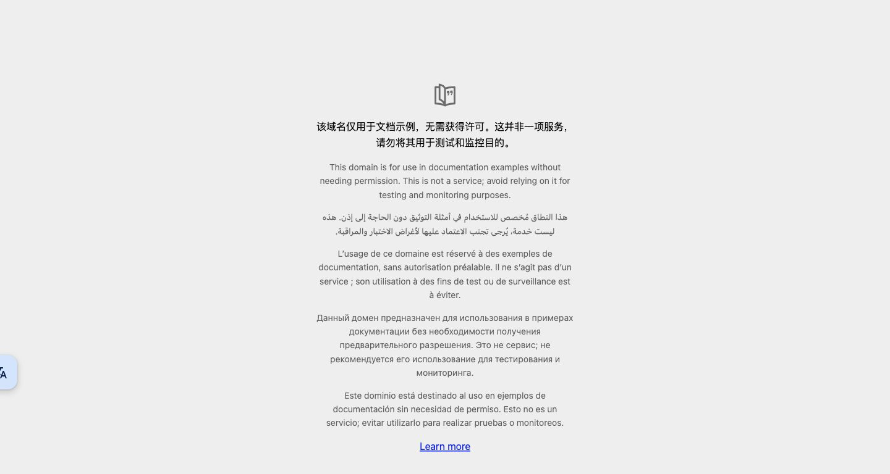

# 办公 Mac：Codex 与 Chrome 恢复资料

恢复入口：**https://github.com/zhangzhuang9675/mac-codex**。

本仓库记录 2026 年 10 月 23 日办公 Mac 的实际修复过程，供用户、Windows 端 Codex，以及这台 Mac 本机的 Codex 在后续恢复时查阅。所有日期以北京时间（Asia/Shanghai）叙述；原始日志中的 `Z` 时间为 UTC。

## 先从这里开始

| 你现在的情况 | 阅读入口 |
| --- | --- |
| 想了解设备、版本、故障原因和完整经过 | [本次恢复报告](docs/2026-10-23-mac-codex-chrome-recovery-report.md) |
| 在 Windows 上通过局域网修复办公 Mac | [Windows 远程恢复步骤](docs/windows-remote-recovery.md) |
| 让 Mac 本机的 Codex 自行诊断和恢复 | [Mac 本机恢复手册](docs/mac-local-recovery.md) |
| 想直接给 Mac 的 Codex 一段指令 | [可复制的恢复提示词](docs/mac-codex-prompt.md) |
| 想核对实际做过的验证 | [组件与浏览器结果](evidence/2026-10-23/verification-after-repair.json)、[连接脚本结果](evidence/2026-10-23/helper-verification.json) |

## 已验证的工作状态

- 设备：`una的MacBook Pro`，Intel `MacBookPro11,4`，macOS `12.7.6 (21H1320)`，16 GiB 内存。
- SSH：`apple@10.1.1.211`。这是本次修复时的局域网地址，后续可能因 DHCP 改变。
- Codex 应用：`/Applications/ChatGPT.app`，Bundle ID `com.openai.codex`，版本 `26.727.51351`，构建 `6119`。应用名称与磁盘目录名称不同，请以实际路径为准。
- 保留原有 **API/provider 配置**。仓库不含 API key、认证文件或可恢复登录的凭据。
- 2026-10-23 已通过真正的 Chrome 插件完成连接、标签页列表、网页导航、DOM、截图、点击、返回和测试标签页清理。

**当前已验证的网络方案依赖 Windows 在线。** Windows 既有代理 `127.0.0.1:10808` 经 SSH 反向转发到 Mac `127.0.0.1:18081`，Mac Codex 使用应用专属代理参数启动。本次没有给 Mac 部署独立代理，也没有设置开机自动恢复。

## 最短的日常恢复方式

在本次 Windows 电脑上，保持原有代理客户端运行，然后执行：

```powershell
& 'E:\CodexBackups\office-mac-chrome-20261023\Connect-OfficeMacChrome.ps1' -LaunchCodex
```

如果脚本不在上述位置，先阅读 [脚本部署说明](docs/windows-remote-recovery.md#从仓库部署连接脚本)。仓库内的 Windows 脚本是已验证脚本的原样副本，仍要求部署到指定 E 盘目录。

如果 Mac Codex 已运行但没有所需代理参数，入口会提示先保存任务并手动退出应用，再重新执行。它不会强制结束活动聊天。

## 本仓库与本地备份的关系

本仓库保存说明、连接辅助脚本、经过整理的验证结果和公开示例页面截图。它是恢复操作参考，不是整机镜像、应用安装包或认证备份。

| 位置 | 内容与用途 |
| --- | --- |
| Mac：`/Users/apple/.codex/repair-backups/chrome-20261023-035751` | 本次修改前的配置副本、旧 Chrome 插件目录和修复后验证；包含私人配置，只留本机 |
| Windows：`E:\CodexBackups\office-mac-chrome-20261023` | 手动连接脚本、运行日志、专用 SSH 状态和修复证据 |
| 本 GitHub 仓库 | 可公开查阅的恢复知识与脚本；没有密钥、原始配置、Chrome 用户资料、私人聊天或原始日志 |

Windows 的 `working-chrome-api-20261020-115255` 是另一套 Windows 恢复基线，不能覆盖到 Mac 上。

## 在 Mac 保留离线副本

网络正常时，可以将仓库保存在 `~/Documents/mac-codex`。当前应用专属代理不会自动供终端 Git 使用；若使用本次 Windows 转发，在 Mac 终端显式指定代理：

```bash
git -c http.proxy=socks5h://127.0.0.1:18081 clone \
  https://github.com/zhangzhuang9675/mac-codex.git \
  "$HOME/Documents/mac-codex"
```

若目录已经存在，先检查它是否为本仓库及是否有未提交修改，不覆盖该目录。Mac 以后无法访问 GitHub 时，可以先读取此副本的 README 和本机手册。副本和报告本身不提供代理、认证文件或完整应用安装包。

## 更新规则

后续修复请新增日期报告，区分“本次实际验证”“历史记录”和“尚未测试的方案”。应用、插件、操作系统或网络条件变化时，先读取现状，再决定是否采用这里的命令。不要为了沿用旧步骤而回退用户配置或切换认证方式。


